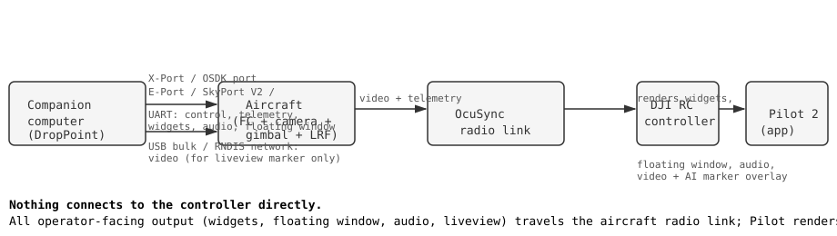
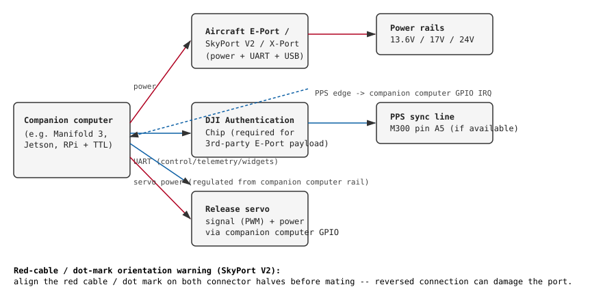

# Connection Guide

**Status: unverified — requires hardware.** Every step below follows
directly from `docs/PSDK-RESEARCH.md` and the build spec's hardware
section, but has not been exercised on a real aircraft in this environment
(hard constraint 2). Treat "what you should see" as the documented expected
behaviour from DJI's own documentation and the PSDK samples, not as a
verified observation.

## 1. System topology diagram



ASCII version, for terminal readers:

```
+-----------------+      E-Port /       +-----------+   OcuSync    +------------+   renders   +---------+
| Companion       |      SkyPort V2 /   | Aircraft  |   radio      | DJI RC     |  widgets,   | Pilot 2 |
| computer        +--------------------->  (FC,      +------------->  controller +------------->  (app)  |
| (DropPoint)     |      X-Port /       | camera,   |   link       |            |  audio,     |         |
|                 |      OSDK port      | gimbal,   |              |            |  video +    |         |
|                 |                     | LRF)      |              |            |  AI marker  |         |
+-----------------+                     +-----------+              +------------+              +---------+
   UART: control, config, data subscription, widgets     (nothing connects to the controller directly --
   USB bulk / RNDIS: video (liveview marker only)          Pilot renders everything DropPoint publishes
                                                            over the normal aircraft link)
```

## 2. Electrical wiring diagram



Key points the diagram encodes:

- **Power**: E-Port supplies the companion computer at 13.6 V, 17 V, or
  24 V (requested by the companion computer at enumeration). Budget for the
  companion computer *plus* the release servo — do not assume the servo can
  run off the same regulated rail without checking current draw.
- **DJI Authentication Chip** sits between the companion computer and the
  aircraft's payload-recognition logic on E-Port/E-Port Lite. Without it,
  third-party payloads are not recognised at all. Procure this chip
  separately (docs/HARDWARE.md).
- **Release servo** power and PWM signal come from the companion computer's
  own GPIO/PWM, never from PSDK (docs/OPEN-QUESTIONS.md #4) — the aircraft
  connector does not carry a servo-control line for this purpose.
- **PPS line** (M300 only, pin A5) feeds a companion-computer GPIO
  interrupt for hardware time discipline (spec 5.5); wire it if available,
  the software falls back to a software offset estimate otherwise and
  reports which mode is active.

## 3. Step-by-step connection procedure

Each step: what to do, what you should see, what to do if you don't.

1. **Identify the correct port for your aircraft.**
   - M350 RTK: E-Port (body) or SkyPort V2 / X-Port (gimbal mount).
   - M300 RTK: OSDK port (UART_RX pin B8, UART_TX pin B5, SYNC_PPS pin A5).
   - M30/M30T: E-Port.
   - Mavic 3E/3T: E-Port, single USB-C — no official development kit as of
     this research pass; expect reduced documentation from DJI.
   - *See:* aircraft's own hardware manual for the exact port location.
   - *If unsure:* check `config/aircraft.yaml`'s `model` field matches
     exactly one of the above; the port name is fixed per model, not
     configurable.

2. **Physical mounting and cabling.**
   - Mount the companion computer per its own thermal/vibration guidance
     (outside this document's scope — see the companion computer vendor's
     manual).
   - **SkyPort V2 warning:** align the red cable mark / dot mark on both
     connector halves before mating. A reversed connection can damage the
     port. Double-check before applying power.
   - *You should see:* the connector seats fully with no visible gap; the
     red marks line up.
   - *If it doesn't seat flush:* stop — do not force it. Re-check
     orientation; a correctly oriented SkyPort V2 connector seats with light
     resistance, not force.

3. **Select the PSDK link mode macro and baud rate for your aircraft.**
   - Set `psdk_link_mode` in `config/aircraft.yaml` to one of `only_uart`,
     `uart_and_usb_bulk`, `uart_and_network`, `only_usb_bulk`,
     `only_network` (docs/PSDK-RESEARCH.md section 8 has the exact macros
     these map to).
   - Set `baud_rate`: M350 RTK / M30 / M30T accept
     115200/230400/460800/921600/1000000; Mavic 3E/3T supports 921600 only.
   - *You should see:* the build's generated `dji_sdk_config.h` (produced
     from this config at build time for the PSDK target) matches your
     selection — check the build log.
   - *If the aircraft rejects the link mode:* some models force USB bulk
     and reject `uart_and_network` — see the troubleshooting table below.

4. **Jetson USB bulk endpoint setup, or Raspberry Pi USB-to-TTL path.**
   - Jetson: configure `/dev/usb-ffs/bulk1` and `bulk2` endpoints — this is
     a documented DJI/Jetson snag; run `scripts/setup_usb_bulk_jetson.sh`
     (ships with the package) before first boot.
   - Raspberry Pi: use a USB-to-TTL UART adapter to the aircraft's UART
     pins; USB bulk video is not available via this path, so the liveview
     marker channel will report unavailable (the system remains fully
     functional without it, per spec section 9).
   - *You should see:* `ls /dev/usb-ffs/` shows `bulk1` and `bulk2` after
     running the setup script and rebooting (Jetson only).
   - *If the endpoints are absent:* re-run the setup script with `sudo`;
     check `dmesg` for USB gadget driver errors.

5. **Power up and confirm enumeration.**
   - Power the aircraft; the companion computer should power on from the
     port's rail.
   - *You should see:* the companion computer's OS boots; `dmesg` shows a
     new UART or USB device appearing at the moment the aircraft link comes
     up.
   - *If nothing enumerates:* check the physical connection (step 2) and
     the power budget (docs/HARDWARE.md) — undervoltage brownouts on
     under-provisioned rails are a common cause.

6. **Install credentials.**
   - Copy `config/credentials.example.yaml` to the path configured for your
     install (default `/etc/droppoint/credentials.yaml`, kept outside the
     package so it survives upgrades) and fill in the five fields from your
     registered app at https://developer.dji.com/user/apps/#all.
   - *You should see:* `droppoint --selftest` reports "credential validity:
     OK" (requires hardware to actually verify against `DjiCore_Init`; see
     `docs/OPEN-QUESTIONS.md`).
   - *If registration fails:* double check `app_id`/`app_key` are copied
     without whitespace; confirm the app is approved (not just created) on
     the DJI developer portal.

7. **Bind the payload with DJI Assistant 2.**
   - Connect the aircraft to DJI Assistant 2 (desktop app) and bind the
     payload once; binding persists across power cycles.
   - *You should see:* DJI Assistant 2 lists the payload as bound under the
     aircraft's payload page.
   - *If binding fails:* confirm the DJI Authentication Chip (step-2
     hardware) is installed and detected — binding fails silently without
     it on E-Port/E-Port Lite.

8. **Verify the widgets appear in Pilot.**
   - Open DJI Pilot 2 with the aircraft powered and the companion computer
     running; navigate to the widget/action-bar panel.
   - *You should see:* SET TARGET, CONFIRM TARGET, CLEAR TARGET, PAYLOAD,
     RELEASE MODE, ARM, RELEASE, and the Source-C cursor controls (grouped
     to fit the 8-widget action-bar limit, docs/PSDK-RESEARCH.md section 4).
   - *If widgets are absent:* confirm `DjiCore_ApplicationStart` succeeded
     in the companion computer's logs; widgets never appear if PSDK
     registration/initialization failed upstream.

9. **Confirm each telemetry topic is arriving.**
   - Run `droppoint --selftest` (or check `/var/log/droppoint/selftest.txt`
     after boot).
   - *You should see:* fused position, attitude, velocity, GPS/RTK status,
     and barometric altitude all reporting "acquired", with an update rate
     consistent with docs/PSDK-RESEARCH.md's topic table.
   - *If a topic is missing:* confirm the subscription request in
     `src/psdk/telemetry_subscription.cpp` (once implemented, see
     `src/psdk/README.md`) matches the topic's actual subscribe call;
     missing topics after that point to a firmware/compatibility mismatch —
     check the aircraft's firmware version against the PSDK release notes.

10. **Verify the rangefinder returns measurements.**
    - With the aircraft powered and a target in view, trigger SET TARGET
      (Source B).
    - *You should see:* the floating window reports distance/bearing and
      elevation source (LRF-corrected vs raw DEM); a raw-DEM-only reading
      means the rangefinder request didn't return in time or the aircraft
      has no rangefinder (`aircraft.yaml`'s `rangefinder_present: false`).
    - *If no measurement ever arrives:* confirm the camera is in a mode
      that supports laser ranging (some zoom/IR modes may not); check
      `DjiCameraManager_GetLaserRangingInfo`'s `exception` field once
      `src/psdk/rangefinder_camera_manager.cpp` is implemented.

11. **Verify the release output actuates on the bench with the payload removed.**
    - **Remove the payload before this step.** With the mechanism armed
      only on the bench (never in flight for this check), send a manual
      RELEASE press and confirm the servo/mechanism moves to its release
      position, then returns to safe on disarm.
    - *You should see:* the mechanism visibly cycles once per RELEASE
      press, never on its own, and always returns to the safe position when
      disarmed or when power is cut.
    - *If it doesn't actuate:* check the GPIO/PWM wiring
      (`src/psdk/release_gpio.cpp`, `docs/HARDWARE.md`) and the self-test's
      "release GPIO responding" line.

## 4. Troubleshooting table

| Symptom | Likely cause | Fix |
|---|---|---|
| Payload not recognised by the aircraft | DJI Authentication Chip missing or not detected | Install the authentication chip (docs/HARDWARE.md); re-bind with DJI Assistant 2 |
| Widgets absent in Pilot | PSDK app registration/init failed | Check companion computer logs for `DjiCore_Init`/`DjiCore_ApplicationStart` return codes; verify credentials |
| Telemetry topics missing | Wrong subscription request, or firmware/PSDK version mismatch | Confirm topic name against docs/PSDK-RESEARCH.md; check aircraft firmware compatibility |
| Video stream unavailable | Link mode doesn't carry video (e.g. `only_uart`), or USB bulk endpoints not configured | Switch to `uart_and_usb_bulk`/`uart_and_network`; re-run the Jetson USB bulk setup script |
| Link mode unsupported on this aircraft | Some aircraft force USB bulk and reject `uart_and_network` | Try `only_usb_bulk`; consult docs/PSDK-RESEARCH.md section 8 for aircraft-specific support notes |
| Authentication chip missing | Third-party E-Port payload without the chip | Procure and install; this is a hard requirement, not a workaround-able one |
| Wrong baud rate | Aircraft rejects an unsupported rate (e.g. requesting 1000000 on a Mavic 3E) | Set `baud_rate` in aircraft.yaml to a rate the model supports (see step 3) |
| USB bulk endpoints absent (Jetson) | Setup script not run, or run before a reboot | Re-run `scripts/setup_usb_bulk_jetson.sh`, then reboot |
